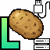
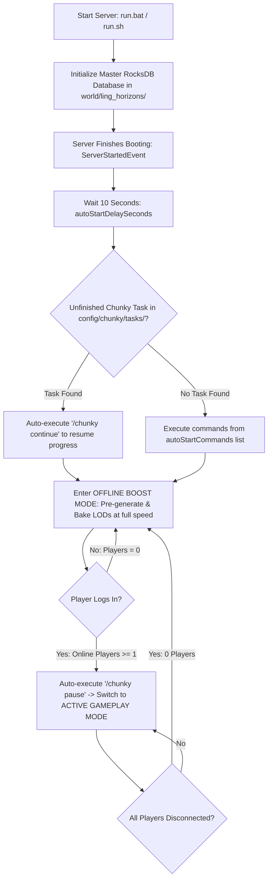

# LING Horizons Server (The Ultimate LOD Streaming Engine)
### Dedicated Server Voxel LOD Streaming & Intelligent Chunky Auto-Bridge for NeoForge 1.21.1

> This is a community fork of [LING Horizons Server by LING](https://github.com/ling-gwdgw2/lingHorizons-Server), licensed under CC BY 4.0. Version `1.0.3-pv1` fixes Java 21 native buffer access, rejects corrupt stored LOD sections, and prevents section workers from spinning after a load failure. The fixes are proposed upstream in [PR #1](https://github.com/ling-gwdgw2/lingHorizons-Server/pull/1). The client/server network protocol remains version 1.



---

##  Table of Contents
1. [Project Overview](#-project-overview)
2. [System Requirements & Prerequisites](#-system-requirements--prerequisites)
3. [Step-by-Step Pre-Launch Setup Guide](#-step-by-step-pre-launch-setup-guide)
   - [Step 1: Install Mod Files onto the Server](#step-1-install-mod-files-onto-the-server)
   - [Step 2: Configure `config/ling_horizons-server.toml`](#step-2-configure-configling_horizons-servertoml)
   - [Step 3: Optimize `server.properties` for LOD Streaming](#step-3-optimize-serverproperties-for-lod-streaming)
   - [Step 4: Configure JVM Startup Arguments (`run.bat` / `run.sh`)](#step-4-configure-jvm-startup-arguments-runbat--runsh)
4. [Server Lifecycle & Automation Workflow](#-server-lifecycle--automation-workflow)
5. [Adaptive Workload Scheduling](#-adaptive-workload-scheduling)
6. [Graceful Fast Shutdown (<1s)](#-graceful-fast-shutdown-1s)
7. [Architecture: Client & Server Mod Pair](#-architecture-client--server-mod-pair)
8. [Frequently Asked Questions & Best Practices (FAQ)](#-frequently-asked-questions--best-practices-faq)
9. [License](#-license)

---

##  Project Overview

**LING Horizons Server** is an industrial-grade **Dedicated Server** mod for Minecraft 1.21.1 (NeoForge). It operates as a centralized **Master Voxel DAG Engine**, persistently indexing, compressing, caching, and streaming high-resolution Level-of-Detail (LOD) distant terrain directly to connected players running the **LING Horizons Client**:

- **Smart Chunky Auto-Bridge & Automation**:
  - Automatically scans for saved, unfinished Chunky pre-generation tasks on disk (`config/chunky/tasks/`). When detected, it immediately issues `/chunky continue` to resume generation without hanging or requiring manual console confirmation.
  - If no existing task is present, the server automatically starts the pre-generation sequence with your configured radius and shape after a safe startup delay.
- **Zero-Lag Gameplay (Dynamic Auto-Pause & Resume)**:
  - **Players Online (>= 1)**: Automatically executes `chunky pause`, yielding 100% of CPU and memory bandwidth to players to guarantee a stable **20.00 TPS**.
  - **Server Empty (0 Online)**: Automatically executes `chunky resume`, utilizing idle server time to pre-generate chunks and bake Voxel LODs in the background.
- **Hierarchical Radial Streaming (Instant Horizon, Zero Void)**:
  - Immediately transmits lightweight, coarse horizon geometry (**Coarse LOD 4 & 3**, ~15–30 KB) upon join or teleport to eliminate visual pop-in and void holes.
  - Progressively streams high-fidelity detail (**Fine LOD 2, 1, 0**) sorted radially outward from each player's position in real time.
- **Adaptive Token-Bucket Bandwidth Limiter**:
  - Throttles LOD packet delivery per player (default 50 KB/s) to prevent network saturation, maintaining ultra-low player ping (**<30ms**) even during rapid flight or exploration.
- **Industrial RocksDB Master Database**:
  - Stores all persistent Voxel LOD data in an embedded, high-throughput RocksDB key-value store located at `world/ling_horizons/`.
- **Safe Fast Shutdown (<1s)**:
  - Intercepts `/stop` commands to pause Chunky instantly, drop async background workers, flush databases cleanly to disk, and exit without server hangs or deadlock.
- **Vanilla & Modpack Friendly**:
  - Players without the LING Horizons Client can join and play normally without being required to install client mods.

---

## System Requirements & Prerequisites

| Component | Minimum Specification | Recommended Specification |
| :--- | :--- | :--- |
| **Java Runtime** | Java 21 (Eclipse Temurin / OpenJDK 21) | Java 21 64-bit with Vector API enabled |
| **Server Platform** | NeoForge 1.21.1 (v21.1.248+) | NeoForge 1.21.1 |
| **CPU** | 4 Cores / 8 Threads | 6+ Cores / 12+ Threads |
| **Dedicated RAM** | 6 GB - 8 GB | 10 GB - 16 GB+ (for large modpacks) |
| **Storage (Disk)** | SSD / NVMe (20–50 GB free space) | High-Speed NVMe M.2 SSD |
| **Required Server Mod**| `lingHorizons-Server-V1-1.0.3-pv1.jar` | `lingHorizons-Server-V1-1.0.3-pv1.jar` |
| **Recommended Mod** | `Chunky` (NeoForge 1.21.1) | `Chunky` (NeoForge 1.21.1) |

---

## Step-by-Step Pre-Launch Setup Guide

Follow these steps **before starting your server for the first time**:

### Step 1: Install Mod Files onto the Server
1. Download or copy **`lingHorizons-Server-V1-1.0.3-pv1.jar`** into your dedicated server's `mods/` directory.
2. Place the **`Chunky`** mod (NeoForge 1.21.1 version) into the `mods/` directory to enable automated pre-generation.
> ⚠️ **Important**: Do **not** install client-only mods (e.g., shaders, visual HUD mods, client-side Voxy) into the server `mods/` folder.

---

### Step 2: Configure `config/ling_horizons-server.toml`
When the server starts for the first time, it generates `config/ling_horizons-server.toml`. You can pre-create or edit this file to suit your hardware:

```toml
# ==============================================================================
# LING Horizons Server Configuration
# ==============================================================================

# Enable or disable the LOD streaming subsystem for connected players (Default: true)
streamingEnabled = true

# Maximum LOD streaming radius per player (in chunks):
# 64 Chunks  = 1,024 blocks radius (Ideal for entry-level VPS or small servers)
# 128 Chunks = 2,048 blocks radius (Recommended for standard dedicated servers)
# 256 Chunks = 4,096 blocks radius (For high-spec dedicated servers and high-speed network)
maxStreamingRadiusChunks = 128

# Maximum network bandwidth throttle per player (in KB/s)
# 50 KB/s delivers rapid LOD loading while keeping network ping low and preventing packet choke
maxBandwidthPerPlayerKB = 50

# Number of background worker threads dedicated to LOD streaming during active gameplay
streamingWorkerThreads = 2

# Enable dynamic workload scheduling based on player presence (Active vs. Offline boost)
adaptiveWorkloadEnabled = true

# Number of worker threads allocated for accelerated voxel baking when 0 players are online
offlineBoostThreads = 4

# Enable automatic Chunky bridge (auto-pause on player join, auto-resume on server empty)
autoManageChunky = true

# Suppress Chunky Auto-Bridge status log messages in the console
silentChunkyBridgeLogs = false

# ------------------------------------------------------------------------------
# Pre-existing World Importer & Auto-Scan
# ------------------------------------------------------------------------------

# Automatically scan and import pre-existing MCA region files into Master RocksDB on server startup if unindexed
autoScanExistingWorldOnBoot = true

# ------------------------------------------------------------------------------
# Auto-Start Chunky on Boot (Automated Pre-generation)
# ------------------------------------------------------------------------------

# Enable or disable automatic Chunky command execution when the server finishes booting
autoStartChunkyOnBoot = true

# Auto-detect saved tasks on disk and execute '/chunky continue' (bypassing console prompts)
autoDetectExistingTask = true

# Delay in seconds after server startup before executing Chunky commands (Default: 10s)
# This allows all world generators, dimensions, and other mods to finish initializing
autoStartDelaySeconds = 10

# Sequence of Chunky commands to execute sequentially on boot (when no existing task is pending)
autoStartCommands = [
    "chunky shape circle",
    "chunky center 0 0",
    "chunky radius 3000",
    "chunky start"
]

# Optional safer multi-dimension queue. When nonempty, this replaces autoStartCommands.
# Exactly one Chunky task runs at a time; players and high load pause it.
# Each dimension starts only after the previous one has finished.
autoStartDimensions = ["minecraft:overworld", "minecraft:the_nether", "minecraft:the_end"]
autoStartRadiusBlocks = 3000
```

The queue requires `autoManageChunky = true`. It saves completed dimensions in
`<world>/ling_horizons/chunky_pregen.properties` and continues unfinished Chunky
tasks after a restart. Set Chunky's `continueOnRestart` to `false` so Chunky does
not resume tasks before the player and load checks. A manual pause or task failure
stops the queue until the next restart. The bridge pauses if heap use exceeds 80%
or the server thread falls more than two seconds behind for three checks, then
retries after load falls. Custom dimension IDs must match the world's registry ID.

---

### Step 3: Optimize `server.properties` for LOD Streaming
Because **LING Horizons Server** streams distant terrain LODs directly to client screens, your server **does not need a high vanilla view-distance**. Lowering vanilla view distance frees up massive CPU ticks, RAM, and bandwidth:

```properties
# Set the server's vanilla chunk view-distance to a moderate value (Recommended: 8 - 10)
# Players will still see horizons up to 128-256 chunks away via the LING Horizons LOD engine!
view-distance=10

# Set entity and tick simulation distance
simulation-distance=8

# Network compression threshold
network-compression-threshold=256
```

---

### Step 4: Configure JVM Startup Arguments (`run.bat` / `run.sh`)
To ensure optimal performance with Java 21's Vector API and G1GC garbage collection, use the recommended startup scripts below:

#### Windows Startup Script (`run.bat`):
```bat
@echo off
java -Xms6G -Xmx10G ^
  --add-modules=jdk.incubator.vector ^
  -XX:+UseG1GC ^
  -XX:+ParallelRefProcEnabled ^
  -XX:MaxGCPauseMillis=200 ^
  -XX:+UnlockExperimentalVMOptions ^
  -XX:+DisableExplicitGC ^
  -XX:+AlwaysPreTouch ^
  -XX:G1NewSizePercent=30 ^
  -XX:G1MaxNewSizePercent=40 ^
  -XX:G1ReservePercent=20 ^
  -XX:G1HeapWastePercent=5 ^
  -XX:G1MixedGCCountTarget=4 ^
  -XX:InitiatingHeapOccupancyPercent=15 ^
  -XX:G1MixedGCLiveThresholdPercent=90 ^
  -jar server.jar nogui
pause
```

#### Linux Startup Script (`run.sh`):
```bash
#!/bin/bash
java -Xms6G -Xmx10G \
  --add-modules=jdk.incubator.vector \
  -XX:+UseG1GC \
  -XX:+ParallelRefProcEnabled \
  -XX:MaxGCPauseMillis=200 \
  -XX:+UnlockExperimentalVMOptions \
  -XX:+DisableExplicitGC \
  -XX:+AlwaysPreTouch \
  -XX:G1NewSizePercent=30 \
  -XX:G1MaxNewSizePercent=40 \
  -XX:G1ReservePercent=20 \
  -XX:G1HeapWastePercent=5 \
  -XX:G1MixedGCCountTarget=4 \
  -XX:InitiatingHeapOccupancyPercent=15 \
  -XX:G1MixedGCLiveThresholdPercent=90 \
  -jar server.jar nogui
```

---

## Server Lifecycle & Automation Workflow

When your server launches, LING Horizons coordinates lifecycle events automatically:



---

## Adaptive Workload Scheduling

| Server State | Operating Mode | Thread Allocation | Chunky State | Impact on Server |
| :--- | :--- | :--- | :--- | :--- |
|**Players Online (>= 1)** | `ACTIVE GAMEPLAY MODE` | 2 Threads (Strict Bandwidth Throttle) | ⏸️ **Paused** | 100% CPU/RAM allocated to game ticks; stable **20.00 TPS** |
|**Server Empty (0 Online)** | `OFFLINE BOOST MODE` | 4 Threads (Max Throughput) | ▶️ **Resumed** | Continuously pre-generates chunks and bakes distant LODs |

---

## 🛑 Graceful Fast Shutdown (<1s)

When the server receives a `/stop` command:
1. **Chunky Auto-Bridge** intercepts `ServerStoppingEvent` and sends `/chunky pause` in under 10 milliseconds, preventing Chunky from writing while worlds are being saved.
2. **Voxel Ingest Service** flags the shutdown and drops any pending asynchronous chunk queues.
3. **RocksDB Master Database** cleanly flushes its memory tables and WAL logs to disk.
4. The server terminates cleanly in **less than 1 second** with zero deadlock or file corruption.

---

## 🧩 Architecture: Client & Server Mod Pair

| Installation Target | Mod File | Destination Directory | Core Responsibilities |
| :--- | :--- | :--- | :--- |
| 🖥️ **Client (Player)** | `lingHorizons-V1-1.0.1.jar` | Player's `.minecraft/mods/` | Renders 3D Voxel DAGs with Compute Shaders; renders horizon views up to 256 chunks with minimal GPU cost |
| 🖧 **Dedicated Server** | `lingHorizons-Server-V1-1.0.3-pv5.jar` | Server's `mods/` directory | Chunky auto-bridge, RocksDB storage, per-player LOD bandwidth limit and nearby LOD delivery first |

> 💡 **Note**: Players who join without the client mod can play normally (Vanilla-friendly). Only players with the client mod will receive distant LOD streaming.

---

## 💻 In-Game & Server Console Commands

LING Horizons provides administrative commands (requires OP permission level 2 or server console):

| Command | Description | Example Usage |
| :--- | :--- | :--- |
| `/ling status` | Displays Master RocksDB status, active streaming players, bandwidth limits, and importer state. | `/ling status` |
| `/ling import [all\|dimension]` | Asynchronously scans and imports pre-existing `.mca` region files directly from disk into Master RocksDB with live progress logging. | `/ling import all` or `/ling import overworld` |
| `/ling cancel` | Cancels an ongoing background `.mca` region import task. | `/ling cancel` |

---

## ❓ Frequently Asked Questions & Best Practices (FAQ)

### 1. Where are the LOD files stored, and should they be backed up?
- The Master Voxel LOD database is stored in **`world/ling_horizons/`**.
- When creating world backups, include this directory. Backing it up ensures that new players immediately enjoy pre-rendered distant terrain without waiting for the server to recompute it.

### 2. How do I change the pre-generation radius or center coordinates?
- Open `config/ling_horizons-server.toml` and modify the `autoStartCommands` section, e.g., change `"chunky radius 3000"` to `"chunky radius 5000"`.

### 3. Can I still use Chunky commands manually via console?
- Yes. You can manually run `/chunky pause`, `/chunky continue`, `/chunky cancel`, or any other Chunky command at any time. The Auto-Bridge will work cooperatively with your manual inputs.

---

## 📜 License

This project is licensed under the **Creative Commons Attribution 4.0 International (CC BY 4.0)** license.

[](https://creativecommons.org/licenses/by/4.0/)

You are free to:
- **Share** — copy and redistribute the material in any medium or format
- **Adapt** — remix, transform, and build upon the material for any purpose, even commercially.

Under the following terms:
- **Attribution** — You must give appropriate credit, provide a link to the license, and indicate if changes were made.

For full license text, see the [LICENSE](LICENSE) file or visit [Creative Commons CC BY 4.0](https://creativecommons.org/licenses/by/4.0/).
